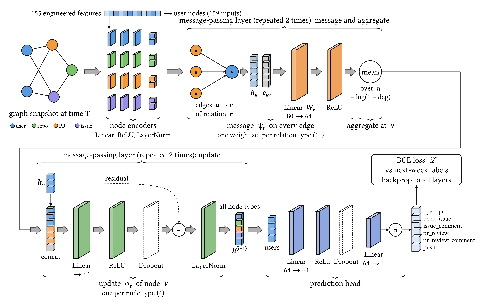
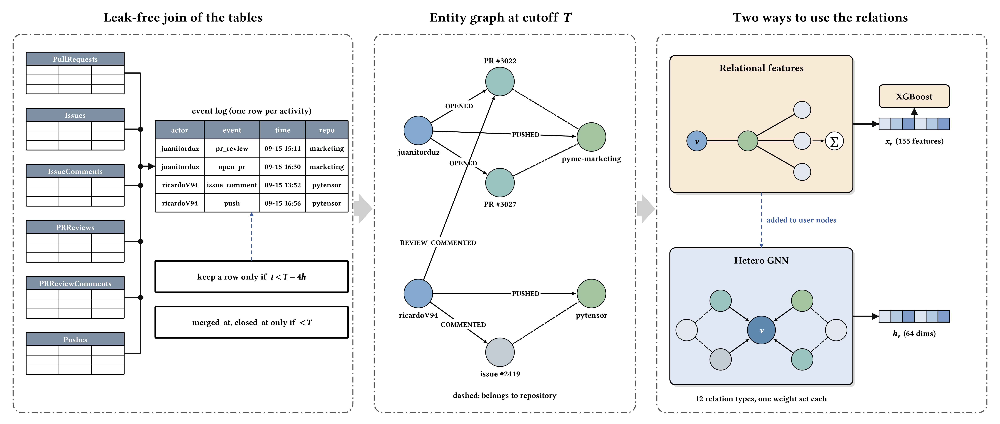
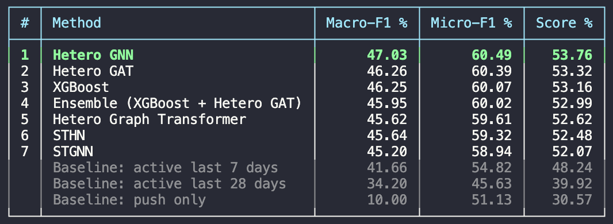

# Assignment 2: Predicting GitHub User Activity






## 1. Rebuild the environment

```bash
conda create -n bigdata-hw2 python=3.10 -y
conda activate bigdata-hw2
conda install -c conda-forge graphviz -y
```

## 2. Install dependencies

```bash
pip install -r requirements.txt
```

## 3. Download the data

```bash
bash scripts/download_data.sh
```


## 4. Train

Set `GPU_ID` in `scripts/train.sh` to a free GPU first (check `nvidia-smi`).

```bash
bash scripts/train.sh
```

## 5. Test

```bash
bash scripts/test.sh
```

```
${BIG_DATA_NYCU_STORAGE}/outputs/hw2/submission/output_314540080.csv
```

Final submission on 11/11 after the 21:00 update:

```bash
bash scripts/download_data.sh
bash scripts/test.sh
```

## 6. Drawing Graphs

```bash
bash scripts/render_graphs.sh
```

## 7. Performance



## Citation

```bibtex
@misc{bigdata2026assignment2,
  title  = {BigData2026 Assignment 2: Predicting GitHub User Activity},
  author = {NYCU Big Data 2026 Fall TAs},
  year   = {2026},
  url    = {https://github.com/nycubigdata-2026fall/BigData2026-Assignment2}
}

@inproceedings{robinson2024relbench,
  title     = {RelBench: A Benchmark for Deep Learning on Relational Databases},
  author    = {Robinson, Joshua and Ranjan, Rishabh and Hu, Weihua and Huang, Kexin and Han, Jiaqi and Dobles, Alejandro and Fey, Matthias and Lenssen, Jan Eric and Yuan, Yiwen and Zhang, Zecheng and He, Xinwei and Leskovec, Jure},
  booktitle = {Advances in Neural Information Processing Systems},
  volume    = {37},
  pages     = {21330--21341},
  year      = {2024}
}

@inproceedings{li2023sthn,
  title     = {Simplifying Temporal Heterogeneous Network for Continuous-Time Link Prediction},
  author    = {Li, Ce and Hong, Rongpei and Xu, Xovee and Trajcevski, Goce and Zhou, Fan},
  booktitle = {Proceedings of the ACM International Conference on Information and Knowledge Management},
  year      = {2023}
}

@inproceedings{wang2020stgnn,
  title     = {Traffic Flow Prediction via Spatial Temporal Graph Neural Network},
  author    = {Wang, Xiaoyang and Ma, Yao and Wang, Yiqi and Jin, Wei and Wang, Xin and Tang, Jiliang and Jia, Caiyan and Yu, Jian},
  booktitle = {Proceedings of The Web Conference 2020},
  pages     = {1082--1092},
  year      = {2020},
  doi       = {10.1145/3366423.3380186}
}

@inproceedings{chen2016xgboost,
  title     = {XGBoost: A Scalable Tree Boosting System},
  author    = {Chen, Tianqi and Guestrin, Carlos},
  booktitle = {Proceedings of the 22nd ACM SIGKDD International Conference on Knowledge Discovery and Data Mining},
  pages     = {785--794},
  year      = {2016}
}
```

## Acknowledgements / License

- Data and `evaluate.py`: [nycubigdata-2026fall/BigData2026-Assignment2](https://github.com/nycubigdata-2026fall/BigData2026-Assignment2), built from [GH Archive](https://www.gharchive.org).
- Graph models follow RelBench and [RelGNN](https://arxiv.org/abs/2502.06784).
- STHN is a reimplementation of [celi52/STHN](https://github.com/celi52/STHN) (CIKM 2023), changed from link prediction to 6-label user prediction.
- STGNN is a reimplementation of [LMissher/STGNN](https://github.com/LMissher/STGNN) (WWW 2020): the 6 event types are the graph nodes, 12 weekly counts are the time steps, and each node outputs the probability of its event next week.
- [TabPFN v2](https://github.com/PriorLabs/TabPFN) pretrained weights (Prior Labs License).
