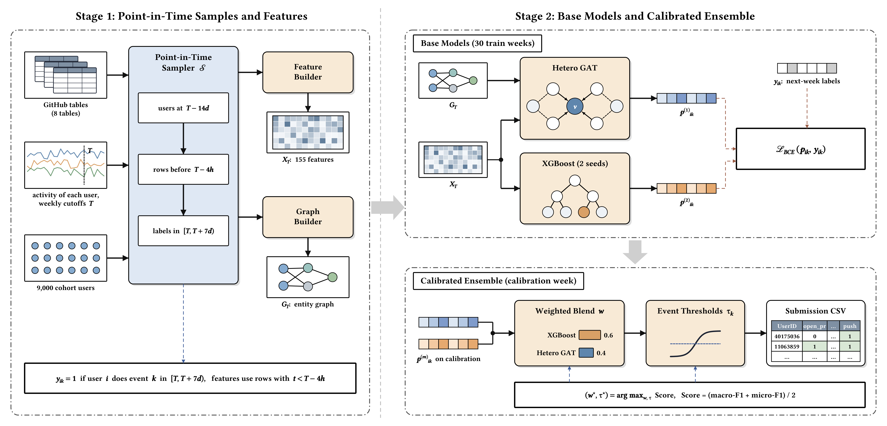
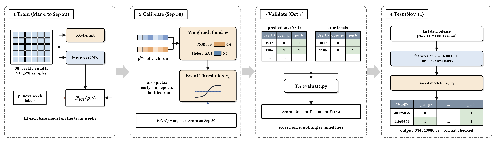

# Assignment 2: Predicting GitHub User Activity






Validation week 10/07 (4,931 users), calibration week 09/30, train 03/04 to 09/23, data release 10/30, scored with the TA `evaluate.py`. Later weeks are not used because Pushes has no rows on 10/15 to 10/17 and none after 10/26.

Every method uses the same inputs: the 155 engineered user features (activity counts over 1 to 91 days, decay, habits, repository context, collaboration). The graph models also keep the 3 raw user columns and a flag on the user nodes (159 inputs).

| Method | Macro-F1 | Micro-F1 | Score |
|---|---|---|---|
| Active last 7 days (baseline) | 41.66 | 54.82 | 48.24 |
| STGNN | 45.20 | 58.94 | 52.07 |
| STHN | 45.51 | 59.40 | 52.45 |
| Hetero Graph Transformer | 45.62 | 59.61 | 52.62 |
| Ensemble: 0.6 XGBoost + 0.4 Hetero GAT | 45.95 | 60.02 | 52.99 |
| XGBoost | 46.25 | 60.07 | 53.16 |
| Hetero GAT | <ins>46.26</ins> | <ins>60.39</ins> | <ins>53.32</ins> |
| Hetero GNN | **47.03** | **60.49** | **53.76** |

Bold is the best and underlined the second best. Each row is the best seed of the method on the validation week.

| Method | What it is | Config |
|---|---|---|
| XGBoost | One gradient boosted tree classifier per event | `xgboost/exp6`, `exp7` (2 seeds) |
| Hetero GNN | Heterogeneous GNN on the entity graph (users, repos, PRs, issues, 12 relation types), mean aggregation of messages | `rdl_gnn/exp5` (2 seeds) |
| Hetero GAT | Same GNN with attention (GAT) aggregation | `rdl_gnn/exp6` (2 seeds) |
| Hetero Graph Transformer | Same GNN with Graph Transformer aggregation | `rdl_gnn/exp7` (2 seeds) |
| STHN | Last 50 events of the user with time encoding, patches and a Transformer | `sthn/exp2` |
| STGNN | 12 weekly counts of the 6 events as a graph of 6 event nodes, GRU and temporal attention | `stgnn/exp2` |
| Ensemble | Weighted average of the probabilities of 8 candidate runs (2 XGBoost, 6 Hetero GNN / GAT / Graph Transformer), then one threshold per event. Weights and thresholds are searched on the calibration week. Chosen: 0.6 XGBoost (0.2 + 0.4 from its 2 seeds) + 0.4 Hetero GAT | `ensemble.short_windows` |

The submitted file is the run with the best calibration score (the ensemble, 58.26), not the best row of the validation table.


## 1. Rebuild the environment

```bash
conda create -n bigdata-hw2 python=3.10 -y
conda activate bigdata-hw2
conda install -c conda-forge graphviz -y
```

## 2. Install dependencies

```bash
pip install -r requirements.txt
```

## 3. Download the data

```bash
bash scripts/download_data.sh
```


## 4. Train

Set `GPU_ID` in `scripts/train.sh` to a free GPU first (check `nvidia-smi`).

```bash
bash scripts/train.sh
```

## 5. Test

```bash
bash scripts/test.sh
```

```
${BIG_DATA_NYCU_STORAGE}/outputs/hw2/submission/output_314540080.csv
```

Final submission on 11/11 after the 21:00 update:

```bash
bash scripts/download_data.sh
bash scripts/test.sh
```

## 6. Q1 graphs

```bash
bash scripts/render_graphs.sh
```


## Citation

```bibtex
@misc{bigdata2026assignment2,
  title  = {BigData2026 Assignment 2: Predicting GitHub User Activity},
  author = {NYCU Big Data 2026 Fall TAs},
  year   = {2026},
  url    = {https://github.com/nycubigdata-2026fall/BigData2026-Assignment2}
}

@inproceedings{robinson2024relbench,
  title     = {RelBench: A Benchmark for Deep Learning on Relational Databases},
  author    = {Robinson, Joshua and Ranjan, Rishabh and Hu, Weihua and Huang, Kexin and Han, Jiaqi and Dobles, Alejandro and Fey, Matthias and Lenssen, Jan Eric and Yuan, Yiwen and Zhang, Zecheng and He, Xinwei and Leskovec, Jure},
  booktitle = {Advances in Neural Information Processing Systems},
  volume    = {37},
  pages     = {21330--21341},
  year      = {2024}
}

@inproceedings{li2023sthn,
  title     = {Simplifying Temporal Heterogeneous Network for Continuous-Time Link Prediction},
  author    = {Li, Ce and Hong, Rongpei and Xu, Xovee and Trajcevski, Goce and Zhou, Fan},
  booktitle = {Proceedings of the ACM International Conference on Information and Knowledge Management},
  year      = {2023}
}

@inproceedings{wang2020stgnn,
  title     = {Traffic Flow Prediction via Spatial Temporal Graph Neural Network},
  author    = {Wang, Xiaoyang and Ma, Yao and Wang, Yiqi and Jin, Wei and Wang, Xin and Tang, Jiliang and Jia, Caiyan and Yu, Jian},
  booktitle = {Proceedings of The Web Conference 2020},
  pages     = {1082--1092},
  year      = {2020},
  doi       = {10.1145/3366423.3380186}
}

@inproceedings{chen2016xgboost,
  title     = {XGBoost: A Scalable Tree Boosting System},
  author    = {Chen, Tianqi and Guestrin, Carlos},
  booktitle = {Proceedings of the 22nd ACM SIGKDD International Conference on Knowledge Discovery and Data Mining},
  pages     = {785--794},
  year      = {2016}
}
```

## Acknowledgements / License

- Data and `evaluate.py`: [nycubigdata-2026fall/BigData2026-Assignment2](https://github.com/nycubigdata-2026fall/BigData2026-Assignment2), built from [GH Archive](https://www.gharchive.org).
- Graph models follow RelBench and [RelGNN](https://arxiv.org/abs/2502.06784).
- STHN is a reimplementation of [celi52/STHN](https://github.com/celi52/STHN) (CIKM 2023), changed from link prediction to 6-label user prediction.
- STGNN is a reimplementation of [LMissher/STGNN](https://github.com/LMissher/STGNN) (WWW 2020): the 6 event types are the graph nodes, 12 weekly counts are the time steps, and each node outputs the probability of its event next week.
- [TabPFN v2](https://github.com/PriorLabs/TabPFN) pretrained weights (Prior Labs License).
